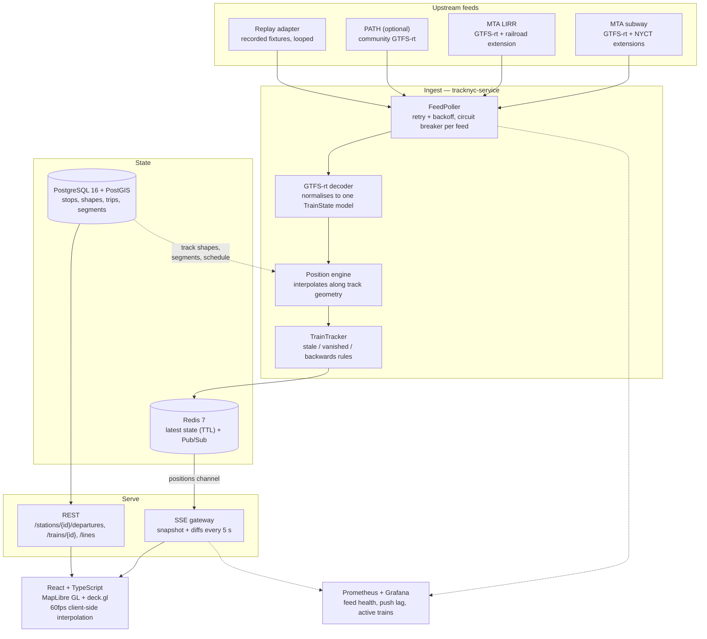

# TrackNYC

**A live map of every train in the NYC region.** Subway and LIRR trains glide across a dark map
in near real time, with live departure boards at every station, delay colouring, and an honest
indicator of how fresh each feed actually is.

The interesting part: **subway trains have no GPS.** They are underground, so the MTA publishes
*predicted arrival times per stop*, not coordinates. TrackNYC works out where each train must be
by interpolating along the real track geometry between the stop it left and the stop it is due
at — which is where most of the engineering in this repo lives (see
[ADR 1](docs/adr/0001-position-estimation-without-gps.md)).


---

## Quick start

```bash
git clone <this repo> && cd tracknyc
cp .env.example .env                       # defaults work as-is; no API keys needed
docker compose -f infra/docker-compose.yml up --build
```

Then open **<http://localhost:8088>**.

The stack starts in **replay mode**: recorded feed snapshots loop at real-time speed through the
same adapters, decoders and position engine the live feeds use, so the map is alive and moving
without any credentials, and without touching the MTA's servers.

> ⚠️ **The bundled fixtures are synthetic.** They are in the real wire formats but the
> timetables are invented and the coordinates are hand-entered approximations. See
> [`fixtures/README.md`](fixtures/README.md) and `scripts/fetch_real_data.sh`.

Services: web `:8088` · API `:8080` · PostGIS `:5433` · Redis `:6380`.
Optional monitoring: `docker compose -f infra/docker-compose.yml --profile monitoring up`
→ Prometheus `:9090`, Grafana `:3000`.

---

## Architecture



**Why it is split this way.** `live-core/` knows nothing about trains: it polls *feeds*, stores
*entities*, pushes *diffs*. Only `tracknyc-service/` knows what a train is. That boundary is
enforced by the module graph, so the foundation could be lifted into a shared library for a
second live-map app without touching it ([ADR 6](docs/adr/0006-monorepo-with-live-core.md)).

```
live-core/
  feed/    FeedAdapter, polling scheduler, retry/backoff, circuit breaker, feed health
  state/   latest-state store with TTLs (Redis / in-memory), Pub/Sub
  push/    SSE gateway: snapshot on connect, coalesced diffs every N seconds
  geo/     polylines, geodesic interpolation, bounding boxes, PostGIS helpers
tracknyc-service/   GTFS loading, realtime decoding, position engine, REST + SSE API
web/                React + TypeScript client (shared/ + trains/)
infra/              docker compose, nginx, Grafana, Prometheus, k6
docs/adr/           architecture decision records
fixtures/           synthetic recordings (see fixtures/README.md)
```

---

## Data sources

| System | Static data | Real-time | Access | Terms to respect |
|---|---|---|---|---|
| **NYC Subway** | MTA GTFS (`gtfs_subway.zip`) | GTFS-realtime trip updates with the **NYCT extensions** (`train_id`, `is_assigned`, track) | [mta.info/developers](https://www.mta.info/developers) | MTA open-data terms; attribution required; not an official MTA product |
| **LIRR** | MTA GTFS (`gtfslirr.zip`) | GTFS-realtime trip updates, MTA railroad stop-time extension, some real GPS | Same MTA portal | As above |
| **PATH** *(optional, off by default)* | PATH GTFS | Community GTFS-realtime feed built from Port Authority data | [path-train-gtfs-realtime](https://github.com/jamespfennell/path-train-gtfs-realtime) | Third-party service — check its terms and be a polite client |
| **Base map** | — | Free vector tiles | [OpenFreeMap](https://openfreemap.org) (no key) | Open data (OpenStreetMap contributors); self-host Protomaps if you need guarantees |

Checked October 2026 — **verify before you build on them.** The MTA has moved these hostnames
before, and the subway feeds currently need no API key even though older documentation says they
do. `MTA_API_KEY` is supported and sent as `x-api-key` only when set.

TrackNYC serves everything from its own backend: browsers never talk to the MTA directly. That
keeps upstream request volume at a handful per minute regardless of how many people are watching
(15 s polling ≈ 5,760 requests/day across all feeds), and means a feed's terms are honoured in
one place.

**This is not an official MTA product and is not affiliated with or endorsed by the MTA.**
Positions are estimates. The UI says so, and shows the age of every feed.

---

## Using the real feeds

```bash
# .env
TRACKNYC_MODE=live
MTA_API_KEY=            # only if your MTA account still issues one
```

Then `docker compose -f infra/docker-compose.yml up --build`. On startup the service downloads
each system's static GTFS, loads it into PostGIS (skipping the load if the feed's fingerprint is
unchanged), rebuilds the segment table, and starts polling. The static data refreshes nightly at
03:30 America/New_York.

To record the real feeds and replay them later:

```bash
./scripts/fetch_real_data.sh                     # downloads static GTFS + records 60 min of realtime
TRACKNYC_FIXTURES_DIR=fixtures-real docker compose -f infra/docker-compose.yml up
```

To enable PATH, set `PATH_FEED_ENABLED=true` and add a `tracknyc.systems.path` entry pointing at
the PATH static GTFS — without a static network its trips have nothing to be placed on.

---

## Development

**In VS Code:** open the repository root and press **F5** → *Backend: replay, no database (nodb)*,
then run the `web: dev server` task — or pick the **Full stack (replay, no database)** compound to
start backend, frontend and Chrome together with breakpoints in both. Run/debug configurations and
tasks are committed in `.vscode/`.

From a terminal:

```bash
# Backend, no database or Redis needed: static GTFS is read from files, state kept in memory
SPRING_PROFILES_ACTIVE=nodb ./gradlew :tracknyc-service:bootRun

# Frontend (proxies /api to localhost:8080)
cd web && npm install && npm run dev        # http://localhost:5173
```

Useful knobs (all in `application.yml`, all overridable by environment variable):

| Setting | Default | What it does |
|---|---|---|
| `tracknyc.mode` | `replay` | `replay` or `live` |
| `tracknyc.position-mode` | `interpolate` | `next-stop` draws trains at their next station instead |
| `tracknyc.motion-profile` | `linear` | `trapezoidal` models acceleration and braking |
| `tracknyc.tick-interval` | `5s` | how often positions are recomputed |
| `tracknyc.push.flush-interval` | `5s` | how often diffs go out to clients |
| `tracknyc.stale.*` | 90s/300s/60s | fade, remove and vanished-train grace periods |
| `tracknyc.state.roles` | `ingest,push` | split ingest and push across processes |

### Tests

```bash
./gradlew build                      # unit tests (fast, no Docker)
./gradlew integrationTest            # Testcontainers: PostGIS + Redis (needs Docker)
cd web && npm test                   # frontend unit tests (vitest)
cd web && npm run typecheck
cd web && npm run e2e                # Playwright smoke test, API mocked
cd web && npm run e2e:live           # ...against a running backend instead
k6 run infra/k6/push-load.js         # push-layer load test (see infra/k6/README.md)
python3 scripts/fixtures/gen_static.py --check   # fixtures still reproducible?
```

### API

| Endpoint | Purpose |
|---|---|
| `GET /api/stream/trains` | SSE: `snapshot`, then `diff` every 5 s, plus `health` events |
| `GET /api/trains` | polling fallback: every train right now |
| `GET /api/trains/{id}` | one train with its remaining stops |
| `GET /api/stations/{id}/departures` | live departure board |
| `GET /api/stations/nearby?lat=&lon=` | stations near a point ("trains near me") |
| `GET /api/lines`, `/api/stations` | GeoJSON line geometry and stations |
| `GET /api/systems` | systems and routes, for the filters |
| `GET /api/feeds/health` | per-feed status, data age, circuit state |
| `GET /actuator/prometheus` | metrics |

Public endpoints are rate-limited per client IP (token bucket, 20 req/s burst 40); the stream is
bounded by the gateway's connection cap instead.

### Metrics

`feed_fetch_latency_seconds{feed,outcome}` · `feed_fetch_errors_total{feed}` ·
`feed_decode_errors_total{feed}` · `feed_data_age_seconds{feed,system}` ·
`feed_status{feed,system}` (0 up … 4 disabled) · `tracknyc_active_trains{system}` ·
`push_connected_clients{stream}` · `push_lag_seconds{stream}` · `push_bytes_total{stream}` ·
`push_dropped_clients_total{stream,reason}` · plus Resilience4j circuit-breaker metrics.

Dashboard: `infra/grafana/tracknyc-dashboard.json`. Alerts: `infra/alerts.yml`.

---

## Decisions

| ADR | Decision |
|---|---|
| [1](docs/adr/0001-position-estimation-without-gps.md) | Estimating train positions without GPS |
| [2](docs/adr/0002-sse-vs-websockets.md) | Server-Sent Events rather than WebSockets |
| [3](docs/adr/0003-redis-state-and-fanout.md) | Redis for latest state and fan-out |
| [4](docs/adr/0004-replay-fixtures-and-clock-offset.md) | Replay adapter with a clock offset, and synthetic fixtures |
| [5](docs/adr/0005-nyct-extensions-without-protoc.md) | Reading the MTA extensions without a protoc build step |
| [6](docs/adr/0006-monorepo-with-live-core.md) | A "live-core" module inside the application repository |

---

## Known limitations

- **The bundled fixtures are synthetic.** Invented timetables, straight-line track geometry,
  hand-entered approximate coordinates. Everything about the *format* is real; nothing about the
  *content* is. See [`fixtures/README.md`](fixtures/README.md).
- **Positions are estimates.** For subway trains they are derived from arrival predictions, so
  they inherit every error in those predictions. `docs/MEASURING.md` explains how to quantify it.
- **Track geometry is only as good as the GTFS shapes.** Where a stop does not snap to its
  trip's shape, the segment falls back to a straight line between stations.
- **Trip matching is best-effort.** NYCT realtime trip ids only partly match the static schedule;
  unmatched trips are still drawn but have no delay figure.
- **No deployment.** `infra/` has a working compose stack; Terraform is a skeleton with a README
  explaining what is left to fill in. Nothing has been deployed to a cloud.
- **Single ingest process.** Fan-out scales horizontally, ingest does not (deliberately — one
  writer keeps positions deterministic).
- **PATH is configured but untested** — no replay recording ships for it, and it needs its own
  static GTFS.

## Roadmap

- **NJ Transit** — the obvious next system. The `TrainState` model and `FeedAdapter` interface
  are already system-agnostic; NJT needs a free developer account and brings its own terms
  (non-commercial use, a request cap, serve from your own backend, no claim of official status,
  and a "may not be real-time" notice in the UI).
- **Metro-North** — same MTA portal, same shape of feed as the LIRR.
- **Replay mode with a time slider** — store 24 hours of positions and scrub through the morning
  rush.
- **Ghost-train detection** — highlight trips that vanish from predictions mid-route (the tracker
  already distinguishes "vanished" from "stale", which is the hard half).
- **Delay heatmap** — where delays accumulate, by hour and by line.
- **Accessibility layer** — elevator and escalator outages from the MTA's accessibility feeds.

---

## Resume bullets

Templates. **Fill in only numbers you have actually measured** — `docs/MEASURING.md` says how.

- Built a real-time regional rail map (Spring Boot, PostGIS, Redis, React, deck.gl) that unifies
  NYC Subway and LIRR feeds and tracks `[X]` active trains with `[Y]`-second update latency.
- Designed a position-estimation engine that converts GTFS-realtime arrival predictions into live
  train coordinates by interpolating along track geometry, since underground trains have no GPS.
- Streamed position diffs over Server-Sent Events to `[N]` concurrent clients in load tests at
  p95 push lag of `[Z]` ms, with per-feed circuit breakers and Prometheus/Grafana monitoring of
  feed health.

## Licence

Code: MIT (see `LICENSE`). Transit data belongs to its publishers and carries their terms; see
the data-source table above.
